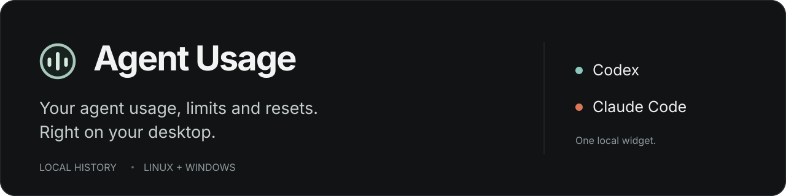
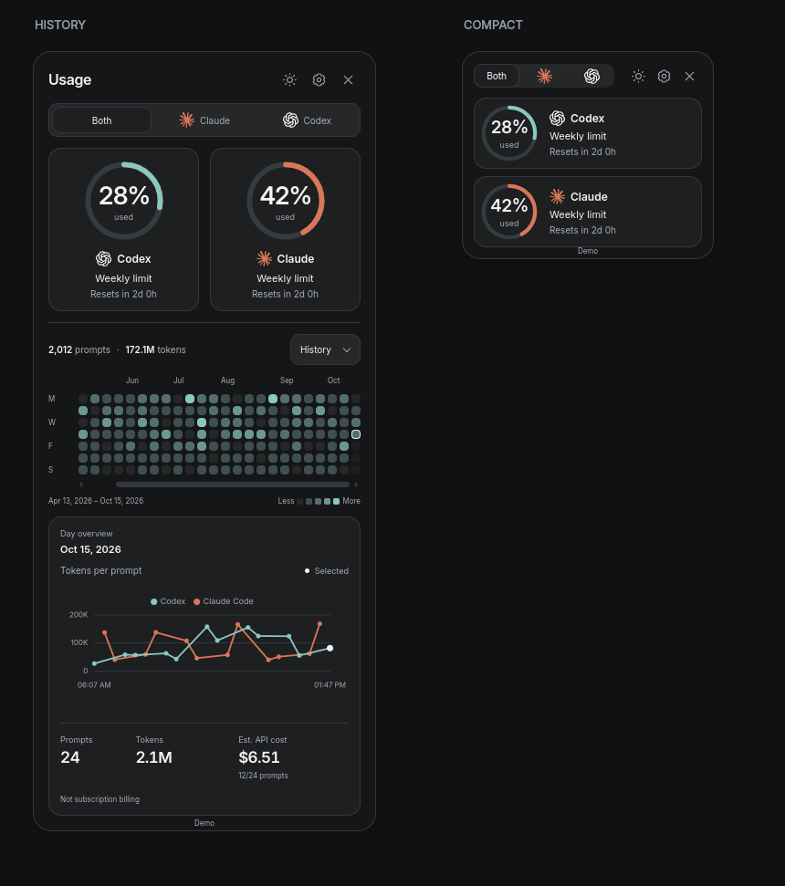
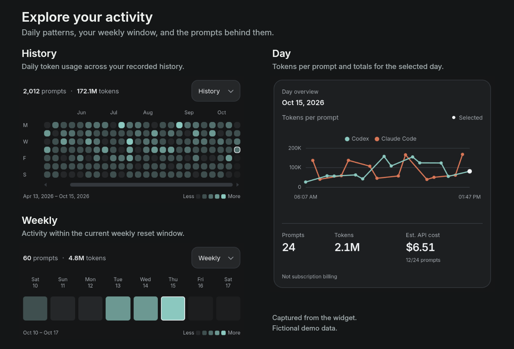

A local desktop widget for **Codex and Claude Code** on Linux and Windows.
Read native session history, check subscription availability, and inspect activity
by day or project. No API key or external collector. Account sign-in opens your browser.

## Get started

**Portable app:** download the archive for your system from
[Releases](https://github.com/RanulfoMNeto/agent-usage/releases), extract the **whole
folder**, and open `agent-usage` on Linux or `agent-usage.exe` on Windows. Python
and Qt are included. Keep the `_internal` directory beside the executable.

On Windows, the first normal launch adds **Agent Usage** to the Start menu and
Windows Search. This works with the portable app and the source command below.
Subsequent launches from the shortcut need no terminal or administrator access.

**From source:** install [uv](https://docs.astral.sh/uv/getting-started/installation/)
and Git, then run:

```sh
git clone https://github.com/RanulfoMNeto/agent-usage.git
cd agent-usage
uv run --locked --no-dev agent-usage
```

Python 3.12–3.14 is supported; uv can supply it. A desktop session is required.
`uv run` runs the source; it does not build a portable `.exe`. Keep the checkout
and its `.venv` for the source shortcut, or the extracted folder for the portable
app. After moving an installation, launch it once again to refresh the shortcut.
An existing agent installation is needed for real data. To try the widget first:

```sh
uv run --locked --no-dev agent-usage --demo
```

Demo mode creates six months of fictional native sessions in a temporary profile.
It makes no account queries and removes its profile on normal exit. It does not
require Codex or Claude Code. Close it to return to your real profile.

Drag the header to move the widget. Its height automatically fits the visible
content. **Compact** shows limits; **Normal** adds activity. Click a day in
**Weekly** or **History** to inspect its chart and totals.
Hover previews; clicking selects. Settings controls appearance, warnings, projects
and sources. The close button quits the app.

## See it in action

<p align="center">
  
</p>



*Real widget captures with fictional demo data. The demo starts in History;
Compact view shows subscription limits only.*

## Connect your agents

Open **Settings → Connections**. Local history is discovered automatically;
account limits use the native interfaces below. Opening the widget never changes
Claude settings or starts a login.

| Agent | Connection | Limits |
| --- | --- | --- |
| Codex | **Connect** reuses your ChatGPT login or opens the official sign-in page | Queried directly through Codex |
| Claude Code | **Enable CLI capture** configures the terminal status line | Reported after a Claude terminal response; **not available from VS Code chat alone** |

Codex is detected on `PATH`, in its standard installation, or inside the official
VS Code, VS Code Insiders or Cursor extension. Its executable handles sign-in and
credentials; the widget does not read or store tokens. Sign-in can be cancelled.
API-key accounts do not supply subscription limits. Windows and WSL are separate
environments. A custom executable can be set with `subscriptions.codex_command`.
[Native account interface](https://learn.chatgpt.com/docs/app-server).

Claude capture requires an existing Claude profile and a subscription signed in
through Claude Code. After enabling capture, restart Claude in a terminal and
complete a request. Login alone does not supply limits. The widget shows
**Waiting for terminal** until data arrives, and marks old readings as outdated.
[Native status-line interface](https://code.claude.com/docs/en/statusline).

Setup preserves other Claude settings and backs up the previous file beside
`settings.json`. Replacing another status line requires confirmation. Earlier
Agent Usage commands are repaired by the same setup action; no command copying
or manual JSON editing is needed. After moving the widget, use this action again.
Capture retains only quota fields. **Receiving limits** means data was actually
received, not merely that setup or sign-in finished.

## Understand the data

- **Limits** are reported by the agent's account interface. They apply to the
  entire account, including when a project filter is active. Local tokens cannot
  reconstruct subscription percentages.
- **Weekly** follows the current reported weekly reset window. **Today** and
  **History** group prompts by their local start date. Different accounts may
  have different reset windows.
- **Tokens** include recorded input and output, including cached input. A prompt
  can involve several model calls. Missing measurements stay unknown.
- **Duration** is exact only when the session records a confirmed duration;
  otherwise it is identified as unconfirmed.
- **API cost** is an estimate, **not a subscription charge**. Native recorded costs
  are used when present; otherwise estimates require an exact model entry in
  [defaults.toml](usage/defaults.toml) or your configuration. The bundled price
  table currently covers only `gpt-6-astra`. Other models show no estimate unless
  pricing or native cost is available. Fast modes and external tool charges are
  excluded. Prices are versioned configuration, not a live pricing feed.

The widget reads existing files; it cannot recover sessions that were deleted
before collection. Native log formats can change between agent versions.

## Local data and privacy

| Agent | Default source |
| --- | --- |
| Codex | `~/.codex/sessions/` and `~/.codex/archived_sessions/` |
| Claude Code | `~/.claude/projects/` |

`CODEX_HOME` and `CLAUDE_CONFIG_DIR` are respected. **Settings → Sources** changes
the directories to read. **Project** selects a repository using the working
directory recorded in sessions, including its subdirectories. Records without
project metadata appear only in the unfiltered view.

The archive contains usage metadata, short prompt titles, project paths and
source-file bookkeeping in SQLite. It does not retain full conversation bodies.
There is no application analytics service or listening HTTP port. Native account
queries may contact the provider through its installed client; this is not an
offline account-limit service.

| System | History and preferences |
| --- | --- |
| Linux | `$XDG_STATE_HOME/agent-usage`, normally `~/.local/state/agent-usage` |
| Windows | `%LOCALAPPDATA%\AgentUsage` |

**Sources → Export / Import** transfers the collected archive as JSON. Import
merges records without duplicates, up to 64 MiB. Changing sources keeps collected
history. Exports can contain private titles and paths; review them before sharing.
To erase collected data, quit the widget and remove its state directory. Original
agent files remain unchanged and will be collected again if the widget is restarted.

## Compatibility

| Environment | Behavior |
| --- | --- |
| Linux desktop | Persistent Qt window; positioning and pinning depend on the compositor |
| GNOME 50 | Optional integration places the same widget on the desktop across workspaces |
| Windows x64 | Persistent window with **Keep on top**; no Rainmeter required |
| macOS, other GNOME versions | Not currently supported by the desktop integration |

CI runs the tests on Linux and Windows, at both ends of the supported Python
range. Release builds extract the distribution archive and exercise its executable
and renderer in an isolated demo. This does not cover every display driver,
desktop or agent version.
Glass is translucent; it does not supply operating-system wallpaper blur.

<details>
<summary>GNOME desktop integration</summary>

```sh
uv run --locked --no-dev agent-usage --install-gnome
```

Sign out and back in. The widget starts at login, stays behind normal windows
on every workspace, and is absent from Alt-Tab. **Keep on top** brings it forward.
GNOME user extensions must be enabled. Portable builds accept the same flag.

Remove with `agent-usage --uninstall-gnome` using the same installation.
History is retained. Remove this integration before deleting or moving the app.

</details>

## Configuration

Defaults are in [usage/defaults.toml](usage/defaults.toml). Overrides live at
`~/.config/agent-usage/config.toml` on Linux (`XDG_CONFIG_HOME` is respected), or
`%LOCALAPPDATA%\AgentUsage\config.toml` on Windows. `--config PATH` selects another
file. No personal configuration belongs in the repository.

```toml
[subscriptions]
codex_command = ["/absolute/path/to/codex"]
```

To disable Start menu shortcut registration:

```toml
[integrations]
windows_shortcut = false
```

This stops future shortcut updates; an existing shortcut is retained.

To update, replace the portable app or pull the source and rerun the locked
command. State stays outside the installation. To uninstall, remove the GNOME
integration if enabled, remove the Claude capture command from its settings,
and delete the application folder and Windows Start menu shortcut. Delete the
state directory separately only if you want to erase the archive.

## Development and support

The Python package is `usage`; the application command is `agent-usage`.
Qt WebChannel connects the bundled UI directly to the collector. The same
readers, SQLite archive, calculations and renderer power the live widget, demo
and packaged builds. Python’s standard library handles collection and storage;
Qt provides the desktop window, rendering and native dialogs.

```sh
uv sync --locked
uv run ruff check .
uv run ruff format --check .
uv run python -m unittest discover -s tests -v
node --check usage/static/assets/app.js
uv build
```

To build a portable app, run `uv run --group build python scripts/package.py`.
Then run `node tests/smoke.mjs dist/agent-usage/agent-usage` (use `agent-usage.exe`
on Windows). Build on the target operating system. Node 22+ is used only by
the packaged UI test. Tags matching the package version, such as `v0.1.0`, trigger
checks, native builds, checksums and a GitHub release.

Report reproducible bugs through [Issues](https://github.com/RanulfoMNeto/agent-usage/issues).
Include versions and redacted screenshots, never full transcripts or credentials.
Keep pull requests focused, reuse the existing readers and UI components, and
add regression tests for behavioral changes. Report vulnerabilities privately
through the repository's **Security → Report a vulnerability** option.

[MIT](LICENSE). Third-party assets retain their licenses. Portable builds bundle
Qt/PySide and their runtime dependencies; see the included license notices.
Maintained by [RanulfoMNeto](https://github.com/RanulfoMNeto). Independent of OpenAI
and Anthropic; their names and logos identify the supported agents.
