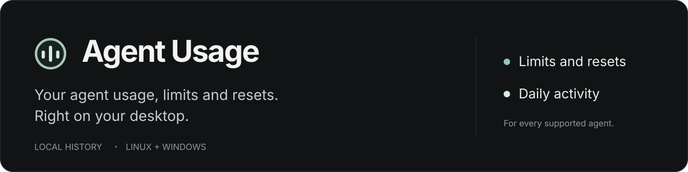
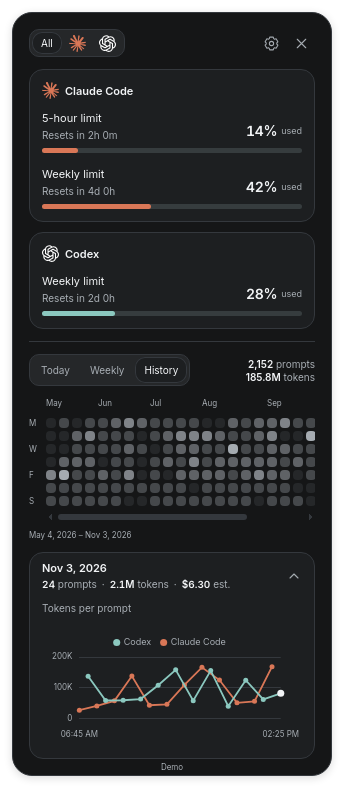
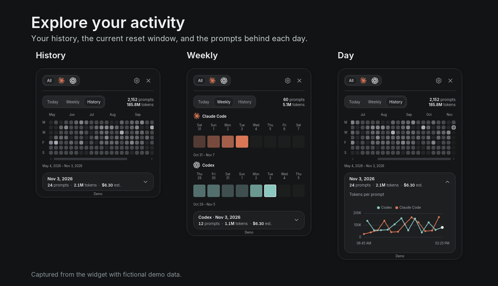

A local desktop widget for **coding agents** on Linux and Windows. It reads each
agent's native session history, shows account limits and when they reset, and
lets you inspect activity by day. On GNOME, limits live in the top bar. No API
key or external collector is needed.

## Supported agents

| Agent | ID | History | Limits | Sign-in |
| --- | --- | --- | --- | --- |
| Claude Code | `claude` | `~/.claude/projects` (`CLAUDE_CONFIG_DIR`) | Usage control request ¹ | Terminal |
| Codex | `codex` | `~/.codex/sessions`, `archived_sessions` (`CODEX_HOME`) | App server account interface | Browser |

Each agent is found on `PATH`, in its native installation directory, or inside its
official VS Code, VS Code Insiders or Cursor extension. Agents handle their own
credentials; Agent Usage never reads or stores tokens, and no sign-in starts on
its own. API-key accounts do not report subscription limits. Windows and WSL are
separate environments.

¹ Claude Code's `get_usage` control request is the **experimental** interface used
by its VS Code extension, verified with version 2.1.301; it may change. Queries send
control requests only, with tools, hooks and session persistence disabled.

New agents are added as modules; see [Adding an agent](#adding-an-agent).

## Get started

**Portable app:** download the archive for your system from
[Releases](https://github.com/RanulfoMNeto/agent-usage/releases), extract the **whole
folder**, and open `agent-usage` on Linux or `agent-usage.exe` on Windows. Python
and Qt are included. Keep the `_internal` directory beside the executable.
On Windows, the first launch adds **Agent Usage** to the Start menu.

<details>
<summary>Windows says the app is from an unknown publisher</summary>

The portable app is not code-signed yet, so Windows cannot name its publisher.
First check that the download is intact: in PowerShell, run
`Get-FileHash agent-usage-windows-x86_64.zip` and compare the hash with
`SHA256SUMS` from the same release.

- **SmartScreen** ("Windows protected your PC"): choose **More info → Run anyway**,
  or open the zip's **Properties**, select **Unblock** and then extract it, so the
  warning does not appear.
- **Smart App Control** blocks unsigned apps and offers no per-app exception.
  While it is on, a release cannot open until releases are signed.

</details>

**From source:** install [uv](https://docs.astral.sh/uv/getting-started/installation/)
and Git, then run:

```sh
git clone https://github.com/RanulfoMNeto/agent-usage.git
cd agent-usage
uv run --locked --no-dev agent-usage
```

Python 3.12–3.14 is supported; uv can supply it. A desktop session is required.
After moving an installation, launch it once to refresh its shortcut.

To try it without any agent installed:

```sh
uv run --locked --no-dev agent-usage --demo
```

The demo creates six months of fictional sessions for every supported agent in a
temporary profile, makes no account queries, and removes the profile on exit.

## Use the widget

<p align="center">
  
</p>

- **Header:** drag it to move the widget. Agent icons filter the activity; the
  gear opens Settings; × hides the widget. Open Agent Usage again, or on Windows
  choose **Show widget** from its notification area icon, to bring it back.
- **Limits:** one card per agent, with each reported window and its reset. When
  the GNOME top bar or the Windows notification area shows limits, the widget
  leaves them out instead of showing them twice.
- **Today**, **Weekly** and **History** choose the period. Click a day to see its
  totals; click the summary below to open its chart and prompts.
- **Settings:** visible limits, bars or rings, a usage warning, theme, style,
  zoom, keep on top, agent connections, history folders, per-agent window schedulers,
  and export or import. The **?** button explains how the numbers are measured.
- **Zoom:** Ctrl + scroll, Ctrl + `+` / Ctrl + `−`, or
  **Settings → Zoom** scales the widget from 50% to 200%; Ctrl + `0` resets it.
  The window grows and shrinks with its content and still fits smaller screens.
  The zoom persists across restarts.
- **Window scheduler:** in **Settings → Agents → Window scheduler**, one switch
  starts an agent's short usage window automatically, early enough that the quota
  resets during your work instead of after it. Each day has one start; from it until
  midnight, a new window starts as soon as the previous one resets. A start missed
  while the app was closed runs as soon as the app runs that day, and a start that
  finds a window already open waits for its reset. A missed start never carries into
  the next day. The chart shows how likely you are to use the agent in each half hour
  (learned from your history), the day's real windows (the open one in the agent's
  color), the planned ones outlined from the next start to midnight, the day's start
  (hollow when it was missed or deferred), now, and dots where the scheduler acted;
  hover it for details. Press the chart to set the start, drag it to
  move it or click it to return to the learned one; **Use learned times** does the
  same. The summary shows the next start, or why there is none: **Off**, **Learning**,
  **Paused** or **Not needed**. The plan is relearned every day from local
  history with zero token usage: three forecasters (weekly rhythm, usual routine and
  recent days) are weighted by how well each predicted every past day, so a new routine
  takes over within a few days, and the start is chosen by simulating that window
  chain on the plausible days ahead. Starts only run while the app is running, no
  window is active and the weekly limit is not reached, in an isolated ephemeral
  session with tools disabled.

The widget's height follows its content. Preferences persist locally and never
affect collection.



## GNOME top bar

```sh
uv run --locked --no-dev agent-usage --install-gnome
```

Sign out and back in. Agent Usage then starts at login, its widget stays behind
normal windows on every workspace, and its icon appears in the top bar. Portable
builds accept the same flag. GNOME user extensions must be enabled.

The top bar menu lists every limit. Check the limits to show in the bar; the menu
stays open while you choose. **Show reset time** adds each limit's countdown.
Values turn yellow at the usage warning and red at 100%. The menu also hides or
shows the widget and quits. A hidden widget stays hidden at the next login and
returns if the extension is disabled. The demo does not publish to the top bar.

After updating, run the command again and sign out and back in. Remove it with
`agent-usage --uninstall-gnome` from the same installation; history is kept.

## Windows notification area

On Windows, Agent Usage adds an icon beside the clock. Windows 11 places new icons
in the overflow (**^**) first; to keep it visible, drag it onto the taskbar or turn
it on under **Settings → Personalization → Taskbar → Other system tray icons**.

Click the icon to open a panel beside it with each limit's use and reset, as the
GNOME top bar menu shows them; hover to see every limit at once. Select one limit in
the panel to show it on the icon: its used percentage, in the agent's color, turning
yellow at the usage warning and red at 100%, and fading while outdated. Selecting
another replaces it; selecting it again clears it. With nothing selected, or while
the selected limit is not reported, the icon is the app's black-and-white one. The
panel closes with a click elsewhere or Escape. The panel and the icon's right-click
menu show or hide the widget and quit. The demo adds no icon.

## Understand the data

- **Limits** come from each agent's account and cover all of its usage. Local
  tokens cannot reconstruct subscription percentages.
- **Weekly** follows each agent's current reset window. **Today** and **History**
  group prompts by their local start date.
- **Tokens** are recorded input and output, including cached input. A prompt can
  involve several model calls. Missing measurements stay unknown.
- **Duration** is shown only when the session records a confirmed duration.
- **Estimated cost** uses standard API prices, **not subscription billing**.
  Native recorded costs are used when present; otherwise a model needs an entry
  under `[prices]` in [defaults.toml](usage/defaults.toml) or your configuration.

Agent Usage reads existing files; it cannot recover sessions deleted before
collection. Native log formats can change between agent versions.

## Connections, data and privacy

**Settings → Agents** connects each agent or pauses its monitoring. Limits are
queried through the installed agent every 60 seconds by default, without model
requests. **Disconnect** pauses collection and queries; sign-ins and history are
kept, and reconnecting collects what was recorded meanwhile. **History folder**
overrides an agent's session directory.

The archive keeps usage metadata, short prompt titles and file bookkeeping in
SQLite, never conversation text. There is no analytics service or network port; a
later launch reaches the running widget through a local channel only your user can open.
Limit queries contact each provider through its own installed client.

| System | History and preferences |
| --- | --- |
| Linux | `$XDG_STATE_HOME/agent-usage`, normally `~/.local/state/agent-usage` |
| Windows | `%LOCALAPPDATA%\AgentUsage` |

**Export / Import** transfers the archive as JSON; imports merge without
duplicates, up to 64 MiB, and accept exports from earlier versions. Exports
contain prompt titles; review them before sharing. To erase collected data, quit
Agent Usage and delete its state directory. Agent files are never modified.

## Configuration

Defaults are in [usage/defaults.toml](usage/defaults.toml). Overrides live at
`~/.config/agent-usage/config.toml` on Linux (`XDG_CONFIG_HOME` is respected) or
`%LOCALAPPDATA%\AgentUsage\config.toml` on Windows; `--config PATH` selects another
file. Agent settings use the IDs from [Supported agents](#supported-agents):

```toml
[agents.codex]
command = ["/absolute/path/to/codex"]   # instead of discovery
history = "/absolute/path/to/history"   # instead of the default directory

[limits]
refresh_seconds = 60

[scheduler]
refresh_seconds = 15

[integrations]
windows_shortcut = false                # stop updating the Start menu shortcut
```

Sections from earlier versions (`[subscriptions]`, `[transcripts]`) are ignored
with a warning. To update, replace the portable app or pull the source; state stays
outside the installation. To uninstall, remove the GNOME integration if enabled,
then delete the application folder and its shortcut.

## Compatibility

| Environment | Behavior |
| --- | --- |
| Linux desktop | Persistent window; positioning and pinning depend on the compositor |
| GNOME 50 | Optional top bar and desktop placement across workspaces |
| Windows x64 | Persistent window with **Keep on top**; limits in the notification area |
| macOS, other GNOME versions | Not currently supported |

CI runs the tests on Linux and Windows at both ends of the supported Python range.
Release builds extract the archive and exercise its executable in an isolated demo.

## Adding an agent

Every agent is a module in [usage/agents](usage/agents) that subclasses `Agent`
from [base.py](usage/agents/base.py); nothing else in the app names a specific agent.

1. Set the attributes: `id`, `name`, `namespace` (hashed into record identities;
   never change it), `colors` for light and dark themes, `monochrome` for a
   single dark icon, `executable`, an editor `extension` prefix if one bundles it,
   and `login` (`"terminal"` or `"browser"` with `login_hosts`).
2. Implement `default_history`, `parse` (one native event into prompt and call
   records from [records.py](usage/records.py)), `read_limits` (normalized windows
   from the native client), `activate_window` (minimal ephemeral turn to open a
   usage window), `demo_session`, and, when needed, `history_files`,
   `install_directories` and `extension_binary`.
3. Register an instance in [usage/agents/\_\_init\_\_.py](usage/agents/__init__.py).
4. Add `usage/static/assets/agents/<id>.svg`. It is also the top bar icon, which
   GNOME recolors, so solid single-color shapes work best.
5. Add parser and limit tests, and a row to [Supported agents](#supported-agents).

## Development and support

The Python package is `usage`; the command is `agent-usage`. Qt WebChannel connects
the bundled UI to the collector, and the same code serves the live widget, the demo
and packaged builds.

```sh
uv sync --locked
uv run ruff check .
uv run ruff format --check .
uv run python -m unittest discover -s tests -v
node --test tests/gnome.test.mjs
uv build
```

To build a portable app, run `uv run --group build python scripts/package.py`, then
`node tests/smoke.mjs dist/agent-usage/agent-usage` (`agent-usage.exe` on Windows).
Build on the target operating system; Node 22+ is needed for the UI tests. The app
icon is `usage/static/assets/widget.svg`; after changing it, regenerate the Windows
icon with `uv run python scripts/icon.py`. Tags
matching the package version, such as `v0.1.0`, trigger checks, native builds,
checksums and a GitHub release.

Report reproducible bugs through [Issues](https://github.com/RanulfoMNeto/agent-usage/issues)
with versions and redacted screenshots, never transcripts or credentials. Keep pull
requests focused and add regression tests for behavioral changes. Report
vulnerabilities privately through **Security → Report a vulnerability**.

[MIT](LICENSE). Third-party assets retain their licenses; portable builds include
the Qt/PySide notices. Maintained by [RanulfoMNeto](https://github.com/RanulfoMNeto).
Independent of the agents' vendors; their names and logos only identify supported agents.
